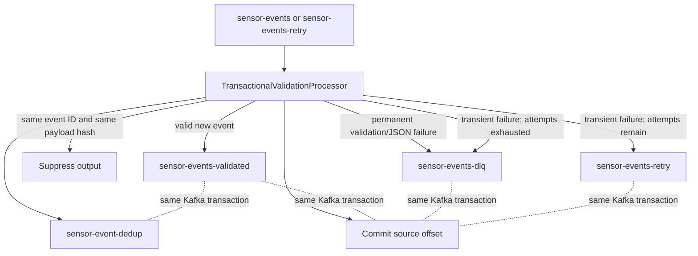

# DE-04D — Bounded Retry and Dead Letter Queue

## Objective and scope

DE-04D adds bounded retry handling to the transactional DE-04C processor.
Transient processing failures are published to `sensor-events-retry`; events
with permanent failures and transient failures that exhaust their configured
attempts are routed to `sensor-events-dlq`. The retry and DLQ actions are
transactional with the source record's offset.

The retry payload is the original serialized event. These records originate
from the DE-03 simulator and are synthetic, not actual IoT measurements.
DE-04D does not add a separate DLQ consumer, external scheduler, database,
warehouse, or exactly-once guarantee for downstream side effects.

## Processing flow



The DLQ receives malformed JSON, non-object JSON, events rejected by the
existing DE-02 validator, event-ID/payload conflicts, malformed retry
envelopes, retry-envelope size failures, and retry-exhaustion records.
Permanent contract failures do not enter the retry topic.

## Retry policy and metadata

`RetryPolicy` in [`retry.py`](../src/atmo_sync/retry.py) validates:

- maximum retry attempts (default `3`);
- base delay (default `1` second);
- maximum delay (default `30` seconds); and
- jitter fraction (default `0.2`, constrained to `[0, 1]`).

Delay is exponential and capped: the nominal delay for attempt *n* is
`base_delay * 2^(n-1)`, capped at `max_delay`, then randomized by the
configured jitter fraction. A zero base delay is allowed for controlled tests.

The processor classifies only explicit `TransientProcessingError` exceptions
as transient. JSON/contract validation errors are permanent. Other unexpected
exceptions are surfaced and do not cause the source offset to be committed;
the record can be redelivered and requires operator/code-level diagnosis.

Each retry envelope carries schema version, event ID when available, original
source topic/partition/offset/key, exact raw payload bytes encoded as Base64,
attempt number, first/last failure timestamps, failure reason, next eligible
attempt time, and retry history. Retry attempts preserve the original source
metadata and raw event bytes.

The retry topic is a single-partition, delete-retention topic, not a compacted
queue. The processor pauses its retry partition when the head retry is not
yet due, then resumes and processes it at or after `next_attempt_at`. Because
the partition is ordered, a future-due retry at its head can delay later
retry records in that partition.

## Transaction and recovery guarantees

`TransactionalValidationProcessor._commit_input()` sends Kafka outputs and
the consumed source offset in one Kafka transaction using
`consumer_group_metadata()`. The offset is sent as `message.offset() + 1`.

| Action | Transaction contents |
|---|---|
| Schedule retry | Retry envelope + source input offset |
| Successful validation | Validated event + dedup marker + source offset |
| Permanent failure / exhausted retry | DLQ envelope + source offset |
| Duplicate event | Source offset only; no output |

If publication fails before commit, the transaction is aborted and the input
offset is not committed. If commit outcome is uncertain, the processor stops
and requires restart with the configured stable transactional identity and
consumer group; it does not update the in-memory ledger speculatively.
Consumers of transactional outputs must use `read_committed`.

The guarantee is atomic Kafka output/offset handling for this processor. It
is not end-to-end exactly-once processing across arbitrary consumers or
external systems.

## Configuration and command

The processor CLI accepts:

| CLI option | Environment variable | Default |
|---|---|---:|
| `--max-retry-attempts` | `ATMOSYNC_MAX_RETRY_ATTEMPTS` | `3` |
| `--retry-base-delay` | `ATMOSYNC_RETRY_BASE_DELAY_SECONDS` | `1.0` |
| `--retry-max-delay` | `ATMOSYNC_RETRY_MAX_DELAY_SECONDS` | `30.0` |
| `--retry-jitter` | `ATMOSYNC_RETRY_JITTER_FRACTION` | `0.2` |
| `--retry-topic` | `ATMOSYNC_KAFKA_RETRY_TOPIC` | `sensor-events-retry` |

The processor also accepts `--bootstrap-servers`, `--input-topic`,
`--validated-topic`, `--dlq-topic`, `--dedup-topic`, and `--group-id`.
Invalid configuration is rejected before processing.

Start Kafka and initialize topics as described in
[DE-04A](de-04-kafka-infrastructure.md), then run:

```powershell
python -m atmo_sync.processor
python -m atmo_sync.processor --max-retry-attempts 5 --retry-base-delay 2 --retry-max-delay 60 --retry-jitter 0.1
```

The `atmosync-processor` console script is also installed by the project.
Stop continuous processing with Ctrl+C; shutdown does not commit offsets
outside Kafka transactions.

## Verification

Unit coverage in `tests/test_retry.py` and `tests/test_processor.py` includes
policy validation, envelope round-trip/raw-byte preservation, transient
retry, bounded exhaustion, permanent DLQ routing, duplicate input during
retry, retry/DLQ publication failure without offset commit, future retry
pausing, and ledger-restoration behavior.

Opt-in Kafka coverage in
[`test_retry_survives_processor_restart_and_is_published_once`](../tests/integration/test_kafka_processor_integration.py)
gracefully closes the first processor instance after transactional retry
publication, creates a replacement in the same Python test process, and
checks that the retry is eventually validated and appears once in the retry
topic. This verifies recovery after graceful instance recreation, not recovery
from an OS-level process crash or forced termination.

The separately gated broker-restart test exercises producer recovery only.
It does not test a broker restart while the processor is unavailable and is
not evidence of processor crash recovery. Actual processor process-crash
recovery remains unverified and requires a dedicated process-level integration
test. The full integration suite is opt-in:

```powershell
$env:ATMOSYNC_RUN_KAFKA_INTEGRATION = "1"
python -m pytest -q tests/integration
```

## Limitations

- One retry partition means a not-yet-due head record can create
  head-of-line delay for later retries.
- Only the explicit transient exception type is retried. Unexpected errors
  stop the processor without committing the affected offset.
- The local broker has one replica and no high availability.
- The processor restart integration test closes and recreates an instance
  within one test process; it does not simulate OS-level crash, forced
  termination, or broker restart while the processor is unavailable.
- DLQ routing is implemented; there is no dedicated DLQ remediation or
  replay application in this milestone.
- Kafka transactions protect Kafka outputs and offsets only. A downstream
  consumer's external side effects are outside this transaction.
