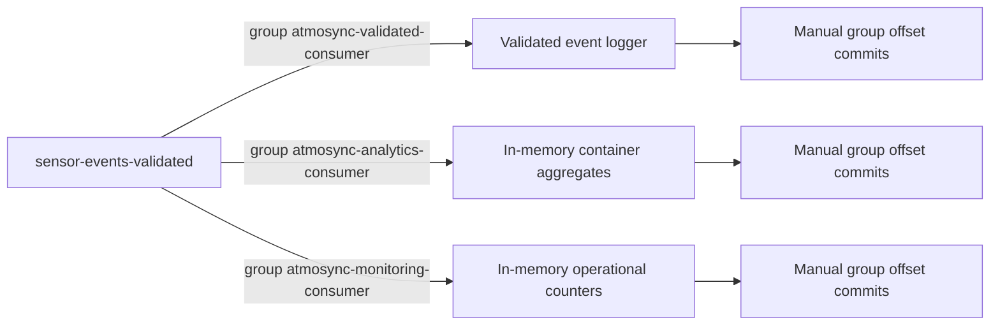

# DE-04E — Independent Downstream Consumers

## Objective and architecture

DE-04E provides three separate downstream applications over
`sensor-events-validated`. Each uses a distinct Kafka consumer group, so each
group receives its own logical copy of the validated stream while instances
within one group divide partitions.



Implementation is split across:

- [`consumers/base.py`](../src/atmo_sync/consumers/base.py): reusable
  configuration, JSON/DE-02 validation, polling, duplicate suppression,
  manual offset commit, and graceful close;
- [`consumers/validated.py`](../src/atmo_sync/consumers/validated.py):
  structured logging of validated events;
- [`consumers/analytics.py`](../src/atmo_sync/consumers/analytics.py):
  process-local sums and event counts by container;
- [`consumers/monitoring.py`](../src/atmo_sync/consumers/monitoring.py):
  process-local event counts/rates and counts by container; and
- [`consumers/consumer_cli.py`](../src/atmo_sync/consumers/consumer_cli.py):
  common CLI configuration and lifecycle.

All consumers set `enable.auto.commit=false`,
`enable.auto.offset.store=false`, and `isolation.level=read_committed`.
They call the handler before a synchronous per-message offset commit.
Invalid JSON or DE-02-invalid events raise `ConsumerError` without committing
the offset. Kafka group coordination and partition assignment are provided
by the Confluent Kafka client through `subscribe()`; the application does
not implement a custom rebalance callback.

## Group configuration and commands

Default groups are:

| Consumer | Default group |
|---|---|
| Validated event logger | `atmosync-validated-consumer` |
| Analytics aggregation | `atmosync-analytics-consumer` |
| Operational monitoring | `atmosync-monitoring-consumer` |

Each command accepts `--bootstrap-servers`, `--topic`, `--group-id`, and
optional `--max-messages`. Environment overrides are
`ATMOSYNC_KAFKA_BOOTSTRAP_SERVERS`, `ATMOSYNC_KAFKA_VALIDATED_TOPIC`,
`ATMOSYNC_KAFKA_CONSUMER_GROUP_ID`, and the consumer-specific
`ATMOSYNC_VALIDATED_CONSUMER_GROUP_ID`,
`ATMOSYNC_ANALYTICS_CONSUMER_GROUP_ID`, or
`ATMOSYNC_MONITORING_CONSUMER_GROUP_ID`.

```powershell
python -m atmo_sync.consumers.validated --max-messages 100
python -m atmo_sync.consumers.analytics --group-id atmosync-analytics-dev
python -m atmo_sync.consumers.monitoring
```

Installed entry points are `atmosync-validated-consumer`,
`atmosync-analytics-consumer`, and `atmosync-monitoring-consumer`.
Omitting `--max-messages` runs continuously. Ctrl+C closes the consumer
without committing an unprocessed message.

## Delivery and duplicate behavior

Kafka group offsets are committed after the handler returns. A bounded
10,000-ID process-local LRU suppresses a recently seen event ID if a commit
fails and that message is redelivered to the same process. This cache is not
durable and does not coordinate across groups.

The analytics and monitoring implementations update in-memory state only.
That state is lost on process restart and is not an external durable
side effect. If a consumer is later given an external side-effecting
handler, a crash after the side effect but before offset commit can cause the
side effect to be repeated. Kafka input offsets are not transactionally
coupled to arbitrary downstream side effects.

## Testing and evidence

`tests/test_consumers.py` covers distinct groups and read-committed/manual
commit configuration, handler-before-commit order, invalid input and handler
failure behavior, commit-failure redelivery, local aggregation/metrics, and
close behavior.

The opt-in
[`test_independent_groups_and_same_group_members_read_committed_events`](../tests/integration/test_consumer_groups_integration.py)
checks that independent groups each receive committed events, that aborted
records are not delivered to read-committed consumers, and that two members
of one group collectively receive the expected committed events. It does
not require a fixed message split.

The separate opt-in
[`test_same_group_rebalance_assigns_both_members_without_loss_or_duplicates`](../tests/integration/test_consumer_groups_integration.py)
starts with one member assigned all six validated-topic partitions, consumes
committed records, then adds a second member to trigger a membership
rebalance. It waits until both members have non-empty, non-overlapping
assignments whose union covers all six partitions. After publishing more
committed records, it checks that each expected event ID appears exactly
once across both handlers and that both members process events. The test
does not assume equal partition or message distribution. It then replaces
the members with a restarted consumer in the same group and verifies that
the already-committed events are not replayed.

Run the integration tests with:

```powershell
$env:ATMOSYNC_RUN_KAFKA_INTEGRATION = "1"
python -m pytest -q tests/integration
```

## Limitations

- Analytics and monitoring state is in-memory and resets on restart.
- The recent-ID guard is bounded and process-local; it is not a durable
  cross-restart deduplication system.
- Handler effects and offset commits are not atomic together.
- The controlled test covers a two-member membership change and restart on
  the local broker; it does not exercise broker failure or every rebalance
  protocol and timing scenario.
- Invalid validated-topic data stops the consumer with its offset
  uncommitted; there is no downstream consumer DLQ in this milestone.
- The local single-broker deployment does not provide production
  availability or security.
