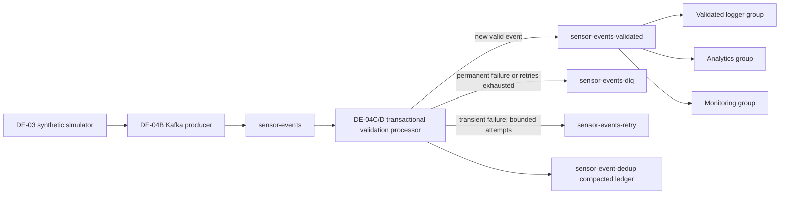
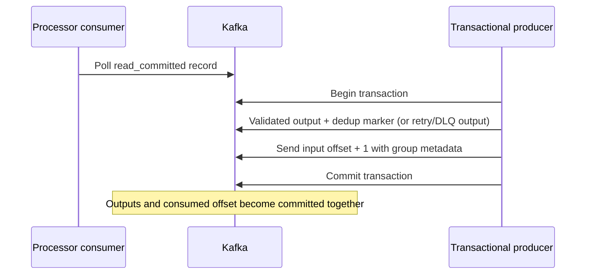

# DE-04G — Kafka Pipeline Architecture and Final Audit

## End-to-end architecture



All event readings produced by the simulator are synthetic. The current
repository has no physical IoT ingestion, Snowflake warehouse, dbt models,
or dashboard implementation.

## Topics

Topic definitions are created and checked by
[`docker/kafka/init-topics.sh`](../docker/kafka/init-topics.sh). The local
broker image is Apache Kafka 3.9.1 in single-node KRaft mode.

| Topic | Partitions | Cleanup | Record limit | Purpose |
|---|---:|---|---:|---|
| `sensor-events` | 1 | delete | 1,048,588 bytes | Raw producer input |
| `sensor-events-validated` | 6 | delete | 1,048,588 bytes | Transactionally validated output |
| `sensor-events-dlq` | 3 | delete | 6 MiB | Malformed/permanent/exhausted records |
| `sensor-events-retry` | 1 | delete | 4 MiB | Delayed retry envelopes |
| `sensor-event-dedup` | 1 | compact | 1,048,588 bytes | Durable event-ID/hash markers |

The broker max message and replica-fetch limits are 6 MiB. Producer and
consumer fetch limits are set to accommodate configured records. The
processor validates topic partition counts and relevant size/cleanup
settings before processing.

## Transaction and recovery model



The processor uses Kafka transactions for its output(s) and consumed offset.
For a new valid event it atomically publishes the validated event and ledger
marker. Retry publication is atomic with the raw source offset. DLQ routing
is atomic with the source offset. Duplicate input commits its offset with no
output. The in-memory ledger is updated only after successful transaction
commit and restored from the compacted topic on restart.

If transaction commit outcome is uncertain, the processor treats the state
as unknown and stops for restart/recovery instead of assuming abort or
success. A fixed transactional ID fences a second instance using that same
ID. Run a single AtmoSync transactional processor configuration; unrelated
processors with different IDs/groups are not globally fenced.

Kafka transaction guarantees apply to Kafka records and offsets consumed
with `read_committed`. They do not extend to arbitrary downstream external
systems; this project does not claim end-to-end exactly-once processing.

### Processor restart-test scope

The processor retry and ledger-restoration integration tests close one
processor instance and create another within the same Python test process.
They verify retry and deduplication recovery after graceful instance
recreation. They do not simulate an OS-level process crash, forced processor
termination, or a broker restart while the processor is unavailable. The
separately gated broker-restart test validates producer recovery only; it is
not evidence of processor crash recovery. Actual process-crash recovery
remains unverified and requires a dedicated process-level integration test.

## Downstream consumer groups

The validated logger, in-memory analytics, and in-memory monitoring apps
have separate default group IDs. Different groups independently read the
validated topic; instances in one group share partitions. The live
controlled-rebalance test waits for both members to receive non-empty,
non-overlapping assignments covering all six partitions, then verifies each
expected committed event ID is delivered exactly once across the group. It
does not assume an equal message split. The test also restarts group
membership and verifies already-committed events are not replayed. All set
`read_committed`, disable automatic offset commit/store, and synchronously
commit after their handler returns.

Analytics sums/counts and monitoring counters are process-local and are
lost at restart. The shared consumer base holds a bounded recent-event-ID
cache (10,000 entries). It does not provide durable side-effect idempotency.
A failure after an external handler succeeds but before offset commit could
repeat that external side effect if such a handler is added.

## Configuration and local operation

Requirements are Python 3.11+ and the declared `confluent-kafka` dependency.
The local broker requires Docker Compose v2 and exposes `localhost:9092`;
Compose-network clients use `kafka:29092`.

Start and initialize the local broker:

```powershell
docker compose up -d kafka
docker compose ps
docker compose exec -T kafka /bin/bash /opt/kafka/scripts/init-topics.sh
```

Run the processor and consumers in separate terminals:

```powershell
python -m atmo_sync.processor
python -m atmo_sync.consumers.validated
python -m atmo_sync.consumers.analytics
python -m atmo_sync.consumers.monitoring
```

The producer command is `python -m atmo_sync.producer --steps 3` or
`atmosync-producer --steps 3`. The processor CLI supports broker/topic/group
options and retry settings; the consumer commands support broker, topic,
group, and optional finite message count. Environment overrides are
documented in the DE-04B, DE-04C, DE-04D, and DE-04E documents linked from
the root README.

## Testing and performance

Run standard checks from the repository root:

```powershell
python -m compileall -q src tests
python -m pip check
git diff --check
docker compose config --quiet
python -m pytest -q
$env:ATMOSYNC_RUN_KAFKA_INTEGRATION = "1"
python -m pytest -q tests/integration
```

The live Kafka suite is opt-in and writes test records to the local topics;
it does not delete topics or volumes. Producer broker-restart recovery has
an additional opt-in flag, `ATMOSYNC_RUN_KAFKA_RESTART_TEST=1`.

Final verification on the current working tree returned exit code 0 for
`compileall`, `pip check`, `git diff --check`, Docker Compose validation,
default pytest, and the live integration suite. The default suite reported
108 passed, 10 skipped, and 49 subtests passed. The live suite reported
9 passed and 1 skipped; the producer broker-restart test requires the
additional opt-in variable above and was not run. The focused consumer-group
module reported 2 passed, and the controlled-rebalance test also passed in
four additional consecutive live runs.

The local performance runs used 34 raw records on one raw partition against
one Docker Kafka 3.9.1 broker. They measured 2.151, 2.530, 5.392, and 5.200
raw records/second; p50 latency was 10,563.118, 9,860.499, 3,361.655, and
5,441.153 ms; p95 latency was 15,587.358, 13,327.001, 6,198.476, and
6,438.042 ms, respectively. In the latest read-committed verification run,
raw and retry application backlog were both zero, and the test verified 30
unique validated events, one retry envelope, and one DLQ record. The timer includes
producer flush, processor initialization/ledger restore, processing,
offset checks, and shutdown; per-event latency includes queueing and final
retry processing. Retry delay and jitter were set to zero for that workload.
These are small-batch functional measurements, not
steady-state or production performance claims. See
[DE-04F testing and performance](de-04f-testing-and-performance.md).

## Final audit findings and milestone status

| Milestone | Evidence-backed status |
|---|---|
| DE-04A | Local single-broker KRaft infrastructure, topic initialization, and broker health are implemented and documented. No HA or production security claim. |
| DE-04B | Kafka producer, delivery callbacks, queue/flush errors, and producer integration test are present. |
| DE-04C | Transactional validation, dedup ledger, DLQ, ledger restoration, and live graceful instance-recreation/abort tests are present. Actual process-crash recovery is unverified. Scope remains Kafka-only. |
| DE-04D | Bounded retry/DLQ implementation, unit coverage, and live retry recovery after graceful instance recreation are present. Actual process-crash recovery is unverified. A single retry partition has head-of-line delay; unexpected exceptions stop without offset commit. |
| DE-04E | Three independent consumer applications and group configuration are present. Live tests verify independent group delivery, non-empty assignment participation for both shared-group members, exact aggregate delivery across a controlled rebalance, and recovery after member restart. In-memory side effects are not durable. |
| DE-04F | Unit/live reliability tests verify retry/DLQ outcomes, exact validated output IDs, and zero read-committed application backlog in the measured workload. Actual small-workload measurements are recorded. This is not a production-style sustained throughput or all-failure-mode certification; broker restart has a separate opt-in. |
| DE-04G | Architecture, topic inventory, transaction/retry/consumer flow, local operation, testing, measurements, and limitations are documented across the DE-04 docs. |

### Retry offset 31 investigation

For the previously reported group offset 31 and retry-topic high watermark
32, direct inspection of the retained Kafka retry partition log identified
offset 31 as a transactional control record:

```text
baseOffset: 31 ... isTransactional: true isControl: true
offset: 31 ... endTxnMarker: COMMIT
```

The retry application record was at offset 30. The group committed position
31 follows that consumed record; the high watermark 32 includes the COMMIT
marker at 31. Thus the reported difference of one in that observed run was
not an unprocessed retry payload. This conclusion is based on the actual
partition log dump, not inferred solely from the high-watermark arithmetic.

### Overall completion verdict

DE-04A through DE-04G have substantial implementation, test evidence, and
documentation in the current tree, but should not be described as fully
certified production milestones. The local DE-04D retry/DLQ and DE-04E
consumer functionality is implemented. DE-04F now has controlled
assignment/rebalance coverage, output-level retry/DLQ/dedup checks, and
read-committed application-backlog accounting. Its small workload, separately
gated broker restart, in-memory consumer side effects, and single-broker test
environment still leave production validation gaps. DE-04G documents those
limits.

For deployment beyond local development, add process-level crash and
processor-unavailable broker-restart testing, multi-broker fault testing,
TLS/authentication, durable consumer side-effect/idempotency design,
broader rebalance-protocol and broker-failure tests, production-sized load
methodology, and operational monitoring/alerting before making stronger
reliability claims.
